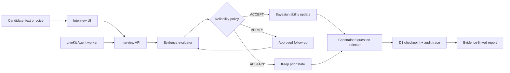

# StatInterview Coach

[](https://github.com/soberlady/statinterview-coach/actions/workflows/ci.yml)
[](LICENSE)
[](https://statinterview-private-lab.keen-grass-7274.chatgpt.site/)

**面向中文数据分析岗位的、不确定性感知的自适应面试训练 Agent。**

产品服务于个人面试前的诊断、练习和复测；作为个人作品，它展示的是
Agent 的状态管理、受约束决策、可靠性控制与可重放执行，不用于企业筛选候选人。
当前版本与真人验收步骤见 [本次训练闭环升级](docs/COACHING_UPGRADE_ZH.md)。

StatInterview Coach does more than generate questions and a final score. It
maintains an explicit ability state, chooses the next approved question under
a fixed interview budget, verifies weak evidence, and preserves a replayable
decision trail from raw answer to final report.

[最新个人训练站（私有）](https://statinterview-private-lab.keen-grass-7274.chatgpt.site/) · [报告改进与验证边界](docs/REPORT_REFINEMENT_ZH.md)
· [Architecture](docs/ARCHITECTURE.md)
· [Evaluation](docs/EVALUATION.md)
· [中文项目导读](docs/PROJECT_GUIDE_ZH.md)
· [投递前行动清单](docs/NEXT_STEPS_ZH.md)
· [Interview guide](docs/INTERVIEW_GUIDE.md)
· [语音排障案例](docs/VOICE_DISPLAY_DIAGNOSTICS_ZH.md)

<p align="center">
  
</p>

## Run the Agent in two minutes

After cloning, install the locked Node.js dependencies and run the real edge
policy against labeled synthetic answers:

```sh
npm ci
npm run demo:agent
```

No API key, Python, database or microphone is needed for this demo. Initial
installation requires internet access. The run produces **8/8 matching
selections**, **3 adaptive decisions**, preserved posteriors for
`VERIFY / ABSTAIN`, and detection of an approved but policy-inconsistent
replacement question. The evaluator uses synthetic fixture scores; selection,
posterior updates and replay execute the production TypeScript policy.

The public showcase reads the same [generated trace](content/agent-demo.json),
including its calculated rankings and fingerprint. Run
`npm run demo:agent -- --check` to verify that the artifact matches the code.
For a Chinese walkthrough and source-reading map, start with
[中文项目导读](docs/PROJECT_GUIDE_ZH.md).

## What makes it an Agent

| Capability | Implementation |
| --- | --- |
| Adaptive decisions | Two public anchors, two frozen JD-directed baselines, then three posterior-adaptive questions selected with uncertainty, information gain, relevance, coverage, difficulty and time constraints. |
| Reliability control | Weak or conflicting evidence triggers a bounded approved follow-up or `ABSTAIN`; an LLM's self-reported confidence is never trusted. |
| Auditable execution | Every answer, state transition, ranking and checkpoint is persisted. Reports replay the complete path, verify five invariants and fingerprint the policy trace with SHA-256. |
| Realtime voice | LiveKit browser audio and a Python Agents worker preserve final raw transcripts, wait for transcript stability, recover checkpoints and fall back safely to text. |
| Evidence-bound scoring | A bounded ASR repair pass precedes two role-separated rubric scoring passes, while quoted evidence must remain a verbatim substring of the original answer. |
| Practice loop | A report creates two guided text exercises and one unseen transfer question, with persisted plans, feedback and a separately interpreted transfer result. |

## Measured result

For the **frozen v2 policy and original 24-question bank**, a deterministic paired simulation of **4,000 candidates** under the same
seven-question budget, the three-stage adaptive policy reduced job-weighted
MAE by **3.83%** versus a fixed sequence. The paired absolute-difference 95%
interval was `[-0.0312, -0.0223]`, and the 90% posterior interval covered
90.0% of simulated latent abilities.

This is evidence about the frozen simulation and implementation—not proof of
hiring validity or real-user learning impact. The effect varies by job profile,
and the formal human-data scorer gate remains `NOT_READY`. See the
[experiment report](docs/EXPERIMENT_RESULTS.md) and
[release checklist](docs/RELEASE_CHECKLIST.md).

The current **coaching-v3 / 48-question** release has a separate
[12-scenario sensitivity regression](content/coaching-benchmark.json): all four
role profiles select different routes for injected low and high scores, with
7/7 matching replay decisions per scenario. This is a behavioral regression,
not a new MAE result or evidence of real-user learning gains.

## System flow



The Python kernel defines the policy mathematics and supports experiments.
The TypeScript policy runs the web API on Cloudflare. Shared golden fixtures
check posterior updates, information gain and utility parity; they do not
claim full session-policy equivalence across both implementations.

## What works now

- end-to-end Chinese text and LiveKit voice interview flows with text fallback;
- 48 curated data-analysis questions and 97 follow-ups with independent weighted rubrics, topic/family metadata and learning points; newly authored content awaits human review;
- report-driven text training: two guided exercises and one unseen transfer question, with exclusions carried through the training chain;
- refresh-safe D1 checkpoints, pause/resume recovery and atomic turn writes;
- question-scoped local drafts with 24-hour validity, replay-safe answer retries and recoverable completion confirmation;
- immutable, session-pinned question-bank snapshots for scoring and historical replay;
- deterministic adaptive selection, bounded verification and explicit
  `ABSTAIN`;
- evidence-linked reports with uncertainty, top-three counterfactual rankings,
  policy replay and tamper detection;
- auditable ASR repair that preserves raw transcripts and protects numeric,
  percentage, negation and causal evidence;
- model, latency and marginal-cost telemetry for voice and semantic scoring;
- Python Agent tests plus TypeScript parity, rendered-output, fault-injection
  and local D1 end-to-end coverage;
- a one-click synthetic guided path and an isolated read-only public showcase;
- a clean-checkout GitHub Actions gate that rebuilds all frozen evidence.

Without a semantic model key, the application enters a labeled structure-only
fallback that cannot update the ability posterior. With an OpenAI-compatible
scorer, two role-separated passes score each rubric criterion; reviewer
disagreement lowers reliability.

## Public demo and safety boundary

The public demo replays `VERIFY -> ABSTAIN -> ACCEPT`, posterior updates,
adaptive rankings and decision audit entirely from fixed synthetic fixtures.
It performs no model calls, database writes, microphone access or candidate
data collection. Operational interview APIs are blocked at the Worker boundary.
The complete data-bearing deployment remains owner-only until per-user
authorization and the human-study release gates are complete.

## Local development

Prerequisites: Node.js `>=22.13`, Python `>=3.11`.

```powershell
npm ci
npm run db:local
npm run dev
```

Open `http://localhost:3000`.

On Windows, double-click `Start-Local-Preview.cmd` to prepare the local database
and start the preview at `http://localhost:4175/`. Keep its terminal window open
while practicing; closing it stops the local service. The launcher reuses an
already running healthy preview. After restarting the computer, start it again
before submitting the setup form.

For a repeatable interview demo, choose **进入引导演示** on the landing page
and use the answer option marked **推荐步骤**. The first weak answer triggers a
bounded verification, the verification remains insufficient and abstains, and
the remaining fixture answers establish evidence before three adaptive turns.

Agent kernel:

```powershell
Set-Location services\agent
python -m venv .venv
.\.venv\Scripts\Activate.ps1
python -m pip install -e ".[dev]"
pytest
```

Voice worker:

```powershell
python -m pip install -e ".[voice,dev]"
Copy-Item ..\..\.env.example ..\..\.env
python -m statinterview_agent.livekit_worker console
```

The browser requests a short-lived room token from
`/api/interviews/:id/voice-token`. The token explicitly dispatches the
`statinterview-coach` worker. Without LiveKit credentials the endpoint returns
`503 VOICE_NOT_CONFIGURED` and the text interview remains available.

Optional semantic scoring uses the three
`STATINTERVIEW_SCORER_*` values documented in `.env.example`. Provider failure
automatically falls back to the labeled structure heuristic.

## Verification

```powershell
npm run doctor
npm run audit:dependencies
npx playwright install chromium
npm run verify
```

`doctor` validates configuration groups and deployment files without printing
secret values. `verify` is the clean-checkout gate used by GitHub Actions: it
validates content, checks all TypeScript types, builds the app, runs
Python/TypeScript/rendered-output tests,
exercises the local D1 API and browser recovery paths end to end and regenerates all frozen synthetic
evidence. `/api/health` provides a non-secret database/question-bank/policy
readiness check for a running deployment.

If optional local credentials are only partially configured, `doctor` will
fail. Use `npm run verify:code` to run the complete code gate without the
configuration preflight; deployment readiness still requires `doctor`.
`verify:code` does not isolate the process from local environment files.
Install the Python test dependencies first:
`python -m pip install -e "./services/agent[dev]"`.

Browser regressions use Playwright with synthetic demo answers and the local
mock scorer. On Windows, Chrome at its standard installation path can be used
without downloading Chromium; `STATINTERVIEW_BROWSER_EXECUTABLE` overrides the
executable. CI installs Chromium automatically. Tests cover draft restore,
response loss, terminal-state retries, completion failures, narrow screens and
the unhinted transfer boundary. Voice processing tests are included in the main
TypeScript test entry point.

CI also audits the complete npm dependency tree, including build tools. A
time-limited, narrowly scoped exception remains for one unfixed upstream
`braces` advisory; it is printed explicitly and expires on 2026-11-04. New
advisories and unavailable audit reports fail the gate. This is not a zero-
vulnerability result. See [dependency upgrade and remaining risk](docs/DEPENDENCY_UPGRADE_ZH.md)
for versions, compatibility checks and the exception boundary.

See [architecture](docs/ARCHITECTURE.md),
[evaluation plan](docs/EVALUATION.md),
[semantic scorer protocol](docs/SCORING_EVALUATION.md),
[voice evaluation protocol](docs/VOICE_EVALUATION.md),
[inference cost protocol](docs/COST_OBSERVABILITY.md), and
[implementation status](docs/IMPLEMENTATION_STATUS.md). The
[release checklist](docs/RELEASE_CHECKLIST.md) keeps machine gates separate
from human-study gates. For interview
preparation, use [INTERVIEW_GUIDE.md](docs/INTERVIEW_GUIDE.md).

## Upstream and licenses

The realtime architecture follows the official
[LiveKit Agents Python starter](https://github.com/livekit-examples/agent-starter-python)
and [LiveKit Meet](https://github.com/livekit-examples/meet) interaction model.
The current repository is an original implementation, not a hidden fork.
See [UPSTREAM.md](docs/UPSTREAM.md) for the exact reuse boundary.
