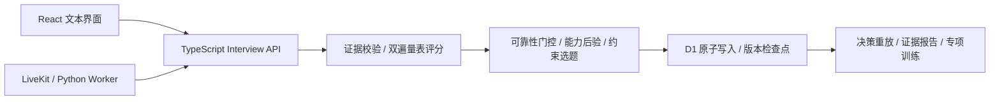

# StatInterview Coach

**面向中文数据分析岗位的自适应面试训练 Agent。** 在七题预算内选择下一题，对不可靠证据追问或弃权，并保留从原始回答到能力状态、训练建议的可重放记录。

这是个人训练与 Agent 工程作品，不用于招聘筛选。重点是**有状态决策、证据门控、持久化恢复与可复现评测**，而非无限生成问题。

[技术文档](docs/README.md) · [代码导读](docs/PROJECT_GUIDE_ZH.md) · [设计问答](docs/INTERVIEW_GUIDE.md) · [许可证](LICENSE)

## 无需密钥的可运行演示

需要 Node.js ≥22.13，首次安装需要网络：

```sh
git clone https://github.com/soberlady/statinterview-coach.git
cd statinterview-coach
npm ci
npm run demo:agent
npm run demo:agent -- --check
```

演示执行实际 TypeScript 策略，以标记为 `DEMO_FIXTURE` 的合成评分驱动：

```text
VERIFY → ABSTAIN → ACCEPT → ACCEPT → ACCEPT → ACCEPT → ACCEPT → ACCEPT
Replay: 8/8; adaptive: 3; terminal: COMPLETE
Approved-question tamper: DETECTED
```

七道正式题加一次验证追问；前两轮不更新后验，后六轮接受合成证据。无需 Python、数据库、麦克风或模型调用。它验证决策机制，不验证真实评分质量。[完整轨迹](content/agent-demo.json)供网页 `/showcase` 使用。

## 架构与技术栈



| 层 | 技术与职责 |
| --- | --- |
| Web | React、Next.js API/路由约定、Vinext/Vite；文本作答、恢复与报告 |
| 决策与存储 | TypeScript、Cloudflare Workers、D1/SQLite、Drizzle；生产 API 和选题策略 |
| Python | Python ≥3.11、Pydantic；数学/实验内核及 LiveKit Agents 语音适配器 |
| 验证 | pytest、Node/tsx tests、ESLint、tsc、Playwright、GitHub Actions、npm/Python 依赖审计 |

Python 与 TypeScript 的 golden fixtures 检查后验、信息增益和效用信号，不代表两端会话策略完全等价。详见[架构](docs/ARCHITECTURE.md)。

## Agent 如何决策

- **2 + 2 + 3**：两个公共锚点、回答前冻结的两个岗位基线、三个后验自适应问题；效用结合信息增益、岗位相关性、覆盖、难度和时间成本。当前题库为 48 道主问题、97 条追问。
- **证据与正确性分开**：双遍评分各自需要原文引用；有评分项缺少有效证据就阻止整次后验更新。明确且有证据的错误回答可以形成可靠低分。低可靠回答进入有界验证；每次诊断最多两次、每个原题最多一次，仍不足则 `ABSTAIN`。
- **原文是事实基准**：转写辅助不能替换原始回答或改变数字、否定和关键语义；模型故障使用保守回退，无语义评分时仅给结构反馈，不更新能力。
- **可恢复、可解释**：D1 batch、检查点版本比较和唯一约束保护写入；重放验证题目与状态，SHA-256 用于复现比较，不是安全签名。报告创建“两题有提示练习 + 一题无提示复测”。

实现入口与取舍见[代码导读](docs/PROJECT_GUIDE_ZH.md)，报告证据规则见[报告设计](docs/REPORT_REFINEMENT_ZH.md)。

## 测试与实验结果

代码基线 `17368d4` 的 [Ubuntu / Python 3.11 CI](https://github.com/soberlady/statinterview-coach/actions/runs/39247270245) 已通过：107 项 Python、30 项工程 JavaScript、132 项 TypeScript 测试，以及 lint、typecheck、生产构建、本地 D1/浏览器故障注入与冻结产物重建。Python 全量结果来自安装语音依赖后的复测。

| 证据 | 结果 | 适用边界 |
| --- | --- | --- |
| 冻结 v2 / 原 24 题仿真 | 4,000 个合成候选人，同一七题预算，加权 MAE 较固定题序降低 3.83% | 仅为 Rasch 仿真，不能外推至当前 v3、真人准确率或学习收益 |
| 当前 coaching-v3 回归 | 12 个注入分数场景，预算与 7/7 决策重放通过 | 行为敏感性，不是新的 MAE 实验 |
| 真人评分 / 语音质量 | `NOT_READY` / `NOT_MEASURED` | 合成夹具不能替代人工双标和真实语音协议 |

实验假设、区间及复现命令见[实验报告](docs/EXPERIMENT_RESULTS.md)；完整证据边界见[评测](docs/EVALUATION.md)。

## 本地网页与工程验证

```sh
npm ci
npm run db:local
npm run dev
```

打开 `http://localhost:3000`，选择“进入引导演示”；只读回放位于 `/showcase`。正常语义评分和实时语音需要独立配置，详见[开发指南](CONTRIBUTING.md)及[语音运行手册](docs/LIVEKIT_RUNBOOK.md)。不配置模型时不会获得可靠语义评分。

完整验证需 Python ≥3.11，并在专用环境安装运行及测试依赖：

```sh
python -m pip install --upgrade pip
python -m pip install -e "./services/agent[dev]" -r services/agent/requirements.txt
npx playwright install chromium
npm run verify
npm run audit:dependencies
npm run audit:python
```

推荐的虚拟环境与平台命令见[开发指南](CONTRIBUTING.md)。`verify` 含配置预检；部分可选配置会使预检失败，`verify:code` 可单独检查代码，但不隔离本地环境文件。两项审计需要网络。

## 真实限制

- 题目难度与评分量表尚未完成真人校准；两遍模型评分不等于独立专家双标，复测分差也不等于长期学习效果。
- 完整数据系统限定可信单一拥有者使用；开放多人访问前仍需主体认证、资源归属和配额。公开展示模式只允许合成回放，参见[安全边界](SECURITY.md)。
- 已保存回答可以幂等重放，但在途重复提交仍可能重复调用外部评分；存储幂等不等于模型调用恰好一次。
- npm 仍有已披露的上游漏洞临时例外，Python 传递依赖尚未完全锁定；详见[依赖风险](docs/DEPENDENCY_UPGRADE_ZH.md)。

未完成事项集中于[验证路线图](docs/NEXT_STEPS_ZH.md)。上游参考与复用边界见[UPSTREAM](docs/UPSTREAM.md)。
