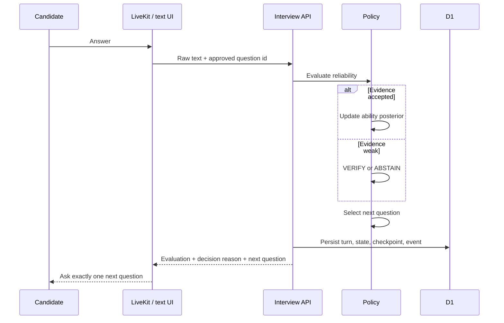
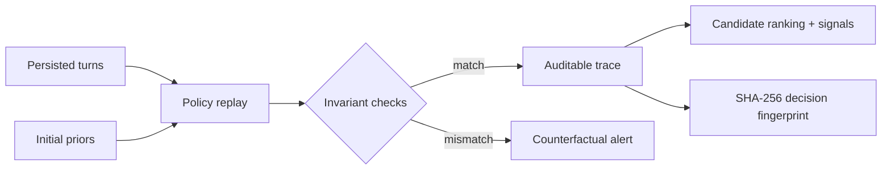
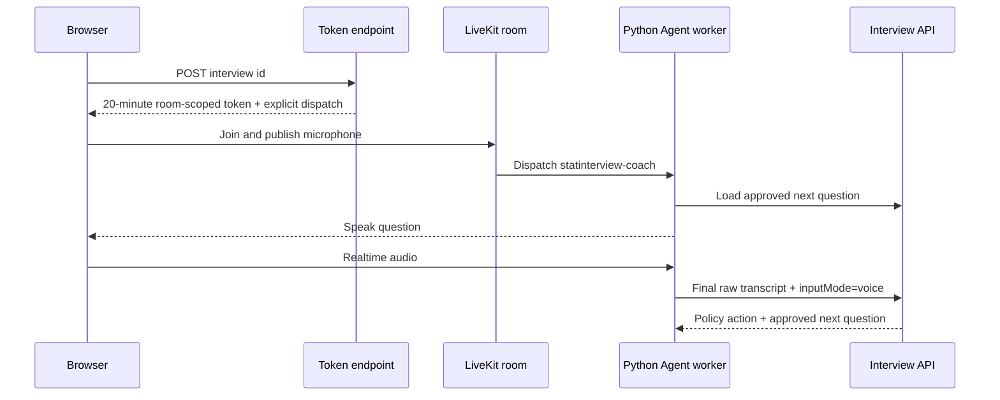

# Architecture

## Coaching v3

New interviews persist `policy_config` with an explicit policy version and optional experience band. Existing rows default to `{}` and use the frozen `agent-policy-v2.ts` selector over the original 24 IDs, preserving old replay behavior. New verification IDs resolve independent follow-up rubrics; legacy IDs retain their original semantics.

The seven-question diagnosis retains two public anchors and two frozen JD baselines. Its remaining three decisions use reliable evidence coverage and a posterior-dependent difficulty target. Clear, quoted incorrect answers are reliable low scores; missing evidence and correctness are separate signals.

A report can create a server-generated, persisted plan with two guided text exercises and one unseen-family transfer question. The plan stores its source, exclusions, topic and learning points. The client cannot choose plan IDs. Practice hints and previous-answer feedback are hidden when the user enters the transfer stage. Voice is disabled for training until its automatic progression can preserve this boundary. Reports interpret the transfer result separately from practice; the training posterior is not a pre/post learning-effect estimate.

Historical v2 simulation artifacts use `content/legacy/question-bank.v1.json`. Current v3 synthetic routing regression is `content/coaching-benchmark.json`; these are distinct evidence sources.

## System boundary

The browser and LiveKit worker are transports. They are not allowed to choose a
question, overwrite a score, or paraphrase stored evidence. All decision state
passes through the interview API.



## State machine

Happy path:

```text
CREATED -> ANCHOR_INTERVIEW -> ADAPTIVE_INTERVIEW
        -> FINALIZING -> COMPLETED
```

`VERIFYING` is a bounded branch. `PAUSED`, `RECOVERING`, `FAILED` and
`CANCELLED` are explicit states so recovery logic is testable rather than
hidden in prompts.

## Three-stage selection policy

Every normal interview budgets seven substantive questions:

1. two public anchors are identical for every session and do not read the JD,
   candidate background or posterior;
2. two JD-directed baseline questions target the highest-weight skill
   dimensions and are frozen from the original JD plus a bounded candidate
   route before answers can affect selection;
3. three posterior-adaptive questions maximize a deterministic utility made
   from information gain, JD relevance, coverage need, difficulty match and
   time cost.

Candidate background is reduced to experience band, preferred difficulty and
bounded scenario tags. Those values can route question difficulty or scenario,
but they never enter rubric scoring or posterior updates. A separate invariant
test proves that the same question and answer produce identical scores and
ability updates under different backgrounds. The adaptive phase excludes a
skill after two consecutive substantive questions from that dimension.

Weak evidence may insert at most two verification turns, with at most one
verification for any source question. Verification turns do not consume the
seven-question substantive budget.

The browser's exit action persists `PAUSED`. Reopening an active checkpoint
enters `RECOVERING` before another turn is accepted. If all policy-selected
questions were already persisted, a paused/finalizing checkpoint may move to
`COMPLETED`; the server recomputes the policy and rejects premature completion.

## Persistence

| Table | Purpose |
| --- | --- |
| `interviews` | Session configuration, current state and versioned checkpoint |
| `interview_turns` | Approved question, raw answer, evidence and evaluation |
| `skill_states` | Ability posterior, uncertainty and accepted evidence |
| `agent_events` | Transition, latency, token/cost and decision audit log |
| `user_feedback` | Human usefulness signal for offline evaluation |

JSON is validated by the API and stored as text for D1/SQLite portability.

The JSON reader counts actual stream bytes and cancels bodies beyond 128 KiB;
Content-Length is only an early rejection hint, not the enforcement boundary.
Question-bound browser drafts are separate from committed records: they have
a 24-hour validity check on access and are cleared after confirmed submission
or explicit removal. They do not replace server checkpoints.

The existing `interviews.mode` field separates `guided_demo` sessions without
adding a parallel schema. In that mode, the API returns versioned synthetic
answer options and bypasses external scorers with an explicitly labeled
`DEMO_FIXTURE` evaluator. Exact fixture answers can exercise deterministic
state transitions; edited answers fall back to structure-only feedback.
Reports retain the mode and evaluator label, and the feedback API rejects demo
sessions so presentation records cannot enter the real-user feedback table.

## Deterministic decision audit

The report does not trust the stored `nextQuestionId` as proof that the policy
ran correctly. It rebuilds the four initial skill states, replays every
persisted evaluation record in sequence and calls the selector again before
each turn. It replays policy and posterior updates; it does not call the
non-deterministic semantic model again. The audit checks five invariants:

1. sequence numbers are continuous;
2. every question comes from the approved bank;
3. every stored evaluation record is parseable and its posterior update can
   be recomputed;
4. the expected and actual question ids match;
5. the final replay reaches `COMPLETE`.

For JD-directed and adaptive turns, the report exposes the top three candidates,
the policy version and selection phase. Adaptive utility is decomposed into
normalized information gain, JD relevance, coverage need, difficulty match and
time cost; the report exposes only the bounded background route, not an extra
background score. A SHA-256 fingerprint makes two replays easy to compare. It is a
reproducibility fingerprint, not a signed security attestation.

The turn API also runs the selector before persistence and rejects an
out-of-order sequence or an approved question that was not selected by the
current policy. The audit is therefore both a write-time invariant and a later
forensic check.

Turn persistence uses one D1 batch for the raw turn, skill-state update,
interview checkpoint and Agent event. A failure in any statement rolls the
whole turn back. The batch also compares the checkpoint version and lifecycle
state read before semantic scoring; a concurrent pause or cancel makes the
whole submission a no-op instead of being overwritten by a stale scorer
response. The client-facing interview PATCH surface can only apply matching
complete, pause, resume or cancel transitions; posterior and checkpoint writes
remain server-authoritative. Client events cannot use the reserved internal
idempotency namespace.

Saved-answer replay does not imply in-flight scorer deduplication. Two concurrent
requests may both call the external evaluator before one wins the checkpoint
comparison. Storage remains unique, but external calls are not exactly-once.
This remains a separate engineering limitation, not a guarantee of the batch.



## Dual implementation

`services/agent` contains the Python mathematics/experiment kernel and voice
adapter. The web API runs the production session policy in
`app/lib/agent-policy.ts` plus `app/lib/rasch-policy.ts`, so text interviews do
not require a Python API server. Shared golden fixtures check posterior updates,
uncertainty summaries, information gain and utility signals; the Python utility
golden test calculates the shared formula rather than exercising its entire selector.
State transitions, reliability actions
and selected question ids remain covered by implementation-specific tests and
should not yet be described as full cross-language parity.

## Evidence scoring and reports

Each pass must independently ground each criterion in raw-answer quotations.
An unsupported criterion contributes no grounded positive score and blocks the
entire answer's posterior update; missing evidence is unknown, not a demonstrated
wrong answer. A grounded incorrect answer can be a reliable low score. Repair
validation always uses the original answer as the factual baseline, including
failure paths; client auxiliary text cannot supply a replacement baseline.

Report interpretation, legacy/JD verification links and transfer comparison are
specified in [report design](REPORT_REFINEMENT_ZH.md). Reports do not rescore
historical answers or treat a narrow follow-up as whole-question mastery.

## LiveKit transport



The browser token endpoint and client room flow are implemented. A deployed
voice-quality claim requires real LiveKit credentials, a running worker and
measured sessions.

## Security and privacy

- API secrets never enter client code.
- Original recordings are disabled by default.
- Stored evidence is the submitted text or LiveKit final transcript, not an
  LLM summary.
- The scoring surface excludes biometric and affective features.
- Reports are explicitly training feedback, not automated employment decisions.
- Structure-only fallback feedback never enters the ability posterior.
- Private scorer-study answers and raw provider predictions are ignored by
  source control; only consented aggregate results may be published.
- The deployed demo remains owner-only. Per-user ownership is a release gate
  for any future shared or public deployment.
